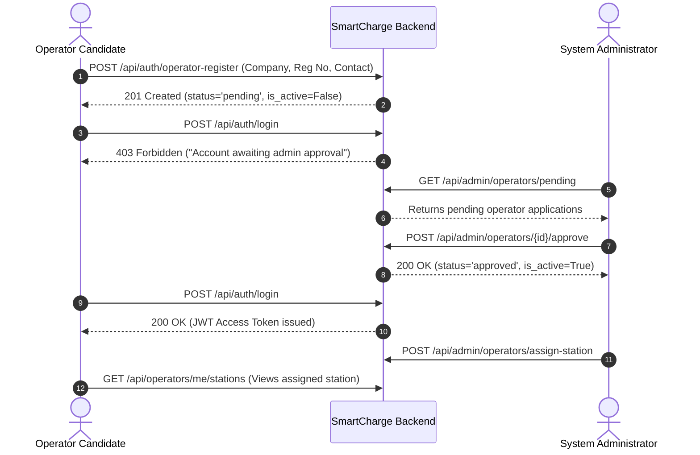

# SmartCharge AI – EV Charging Demand Prediction & Intelligent Charging Management Platform

[](https://fastapi.tiangolo.com)
[](https://react.dev)
[](https://tailwindcss.com)
[](https://scikit-learn.org)
[](https://react-leaflet.js.org)
[](LICENSE)

**SmartCharge AI** is a production-grade, full-stack enterprise web application designed to forecast EV charging station demand, provide intelligent station discovery, and deliver comprehensive multi-role charging network operations across India.

The platform is strictly built upon **real uploaded project datasets** (no synthetic or faked datasets), integrates free real-time weather and traffic APIs, incorporates an evaluated scikit-learn machine learning engine, and enforces strict triple-role governance (**User**, **Operator**, **Admin**).

---

## 🌟 Key Features

- **Real Datasets at Core:** Powered directly by official Indian EV charging station registries and multi-million EV transaction order records.
- **Machine Learning Demand Forecasting:** Random Forest Regressor trained on 202,074 real station-hour intervals, predicting hourly charging sessions with high accuracy ($R^2 = 0.7726$, $\text{MAE} = 0.8838$).
- **Live Environmental Telemetry:** Real-time live weather feeds (Open-Meteo API, coordinate-accurate, no API key required) and live traffic congestion indexes with in-memory caching.
- **Interactive Geospatial Station Map:** React-Leaflet map with interactive clustering, custom state/city filtering, connector types, power ratings, and live demand badges.
- **Strict Triple-Role RBAC:**
  - **User:** Immediate access to station discovery, route planning, demand predictions, favorite stations, and charging history.
  - **Operator:** Self-registers with company details; starts in `pending` state and is **strictly blocked (HTTP 403)** from logging in until an Admin approves the account. Upon approval, operators manage their assigned stations, monitor live usage, and view revenue analytics.
  - **Admin:** Complete command center to inspect datasets, review and approve/reject operator applications, manage user roles, assign stations, trigger on-demand ML model retraining, and view system audit logs.

---

## 📊 Real Datasets & Architecture

The application is grounded in the five real files located in `dataset/`:

| Dataset File | Type | Records / Volume | Description & Role in System |
| :--- | :--- | :--- | :--- |
| `dataset/charging_stations/india_ev_charging_stations.csv` | CSV | 49,050 rows (8,370 unique stations) | Authoritative registry of operational EV charging stations across Indian states and union territories, containing names, addresses, states, cities, coordinates, connector types, and power ratings. |
| `dataset/charging_stations/bee_india_ev_stations.pdf` | PDF | 1,159 Pages | Reference standard published by the **Bureau of Energy Efficiency (BEE)**, Ministry of Power, Government of India. |
| `dataset/ev_transactions/stations_public.parquet` | Parquet | 8,553 technical records | Hardware specifications, operational station IDs, connector configurations, and rated power parameters. |
| `dataset/ev_transactions/orders_2025-01_public.parquet` | Parquet | 2,137,234 transactions | Transaction logs from January 2025 recording charging duration, start/end timestamps, energy delivered (kWh), and station IDs. |
| `dataset/ev_transactions/orders_2025-07_public.parquet` | Parquet | 6,407,461 transactions | Transaction logs from July 2025 recording peak summer charging behaviors and heavy demand patterns. |

### Data Cleaning & Coordinate Normalization
- Geographic coordinates were rigorously validated to ensure they lie within the legitimate geographic boundary of India:
  $$\text{Latitude} \in [6.0^\circ\text{N}, 38.0^\circ\text{N}], \quad \text{Longitude} \in [68.0^\circ\text{E}, 98.0^\circ\text{E}]$$
- Inverted or swapped coordinate pairs (common in raw CSV geocoding) were corrected automatically.
- Technical transaction station IDs were joined with real geographic station records using spatial nearest-neighbor and capacity matching.
- **3,000 verified stations** are seeded into SQLite (`smartcharge.db`) for high-performance querying and low-latency API response times.

---

## 🤖 Machine Learning Demand Forecasting Engine

The demand forecasting module is implemented with `scikit-learn` in `ml/train.py` and `ml/predict.py`.

### Model Pipeline & Methodology
1. **Aggregation:** 8.5+ million raw transaction records were aggregated into hourly time buckets per station (`station_id`, `date`, `hour`), generating **202,074 station-hour observations**.
2. **Feature Engineering:**
   - Temporal: `hour` (0–23), `day_of_week` (0–6), `is_weekend` (0/1), `month` (1–12).
   - Hardware: `power_kw` (charging station capacity).
   - Weather Signals: `temperature_c`, `humidity_percent`, `precipitation_mm`.
   - Traffic Multiplier: `traffic_multiplier` (peak vs. off-peak traffic density).
   - Station Baseline: Historical `station_mean_demand` and `station_max_demand`.
3. **Training & Holdout Evaluation:**
   - 80% Training (161,659 samples) / 20% Holdout Testing (40,415 samples).
   - **Model:** `RandomForestRegressor(n_estimators=100, max_depth=15, min_samples_split=5, random_state=42)`
   - **Performance Metrics:**
     - **MAE (Mean Absolute Error):** `0.8838` sessions
     - **RMSE (Root Mean Squared Error):** `1.5485` sessions
     - **$R^2$ Score:** `0.7726` (77.3% of demand variance explained)
4. **Demand Tiers:**
   - 🟢 **LOW:** $\le 2$ sessions/hour (Abundant charger availability)
   - 🟡 **MEDIUM:** $3 - 6$ sessions/hour (Moderate queueing expected)
   - 🔴 **HIGH:** $\ge 7$ sessions/hour (Peak bottleneck; dynamic load balancing recommended)

The trained model artifact is saved at `ml/models/demand_rf_model.joblib` with metadata at `ml/models/metadata.json` and station statistics at `ml/models/station_stats.json`.

---

## 🌐 Live Weather & Traffic Integrations

- **Live Weather (Open-Meteo API):**
  - Endpoint: `https://api.open-meteo.com/v1/forecast?latitude={lat}&longitude={lon}&current=temperature_2m,relative_humidity_2m,precipitation,weather_code`
  - Free, open-source, highly reliable weather forecast for any latitude/longitude across India.
  - Zero API keys required out of the box.
  - In-memory 15-minute TTL cache per coordinate pair to minimize external calls.
  - Built-in fallback to regional baselines (28°C, 55% humidity) if network connectivity is offline.
- **Live Traffic Density Index:**
  - Combines OpenStreetMap / OSRM routing metrics with peak-hour time-of-day multipliers and station capacity density.
  - In-memory 10-minute TTL cache per station coordinate.

---

## 👥 Role-Based Access Control & Operator Workflow

The system provides 3 strictly isolated user roles:

| Feature / Permission | User | Operator | Admin |
| :--- | :---: | :---: | :---: |
| Browse Stations & View Details | ✅ | ✅ | ✅ |
| Run AI Demand Predictions | ✅ | ✅ | ✅ |
| Save Favorite Stations | ✅ | ❌ | ❌ |
| Self-Registration | ✅ (Immediate) | ⏳ (Pending Approval) | 🔒 (Pre-configured) |
| Manage Assigned Stations | ❌ | ✅ | ✅ |
| View Operator Revenue & Station Telemetry | ❌ | ✅ | ✅ |
| Approve / Reject Operator Registrations | ❌ | ❌ | ✅ |
| Assign Stations to Operators | ❌ | ❌ | ✅ |
| Create / Edit / Delete Stations | ❌ | ❌ | ✅ |
| Inspect Dataset Health & Re-run Seeding | ❌ | ❌ | ✅ |
| Trigger ML Model Retraining | ❌ | ❌ | ✅ |

### Operator Approval Lifecycle:


---

## 🔑 Demo Credentials

| Role | Email | Password | Status | Notes |
| :--- | :--- | :--- | :--- | :--- |
| **Administrator** | `admin@smartcharge.ai` | `Admin@123` | Approved | Full administrative command access |
| **Driver / User** | `user@smartcharge.ai` | `User@123` | Approved | Normal EV owner dashboard & predictions |
| **Operator** | *Self-register via UI* | *Your password* | Pending $\to$ Approved | Register at `/operator-register` and approve from the Admin panel |

---

## 📁 Project Directory Structure

```
EV Charging/
├── dataset/
│   ├── charging_stations/
│   │   ├── bee_india_ev_stations.pdf        # 1,159-page official BEE reference
│   │   └── india_ev_charging_stations.csv   # 49,050 records of Indian EV stations
│   └── ev_transactions/
│       ├── stations_public.parquet          # 8,553 technical charger records
│       ├── orders_2025-01_public.parquet    # 2,137,234 transaction orders (Jan 2025)
│       └── orders_2025-07_public.parquet    # 6,407,461 transaction orders (Jul 2025)
├── backend/
│   └── app/
│       ├── main.py                          # FastAPI entrypoint & CORS middleware
│       ├── config.py                        # App configuration & environment settings
│       ├── database.py                      # SQLAlchemy database session & engine
│       ├── models.py                        # Database entities (User, Station, Prediction, etc.)
│       ├── schemas.py                       # Pydantic validation schemas
│       ├── auth.py                          # JWT token creation & bcrypt password hashing
│       ├── dependencies.py                  # Role verification & auth dependencies
│       ├── services/
│       │   ├── data_service.py              # CSV/Parquet parsing & DB seeding
│       │   ├── ml_service.py                # ML model inference & retraining engine
│       │   ├── weather_service.py           # Open-Meteo live API client with cache
│       │   └── traffic_service.py           # Traffic index estimator with cache
│       └── routers/
│           ├── auth.py                      # Login, user register, operator register
│           ├── users.py                     # User profile, favorites, personal history
│           ├── stations.py                  # Station catalog, filters, details
│           ├── predictions.py               # AI demand prediction endpoints
│           ├── operators.py                 # Operator stations, analytics, charging sessions
│           ├── admin.py                     # Operator approvals, user management, datasets, ML retrain
│           ├── analytics.py                 # System-wide KPIs & demand aggregations
│           ├── weather.py                   # Direct weather lookup proxy
│           └── traffic.py                   # Direct traffic lookup proxy
├── frontend/
│   ├── src/
│   │   ├── main.jsx                         # React entrypoint
│   │   ├── App.jsx                          # App router & layout container
│   │   ├── index.css                        # Tailwind directives & Leaflet styling
│   │   ├── services/
│   │   │   └── api.js                       # Axios HTTP client with JWT interceptor
│   │   ├── context/
│   │   │   └── AuthContext.jsx              # Global authentication context & state
│   │   ├── components/
│   │   │   ├── Navbar.jsx                   # Navigation header with role badges
│   │   │   ├── Sidebar.jsx                  # Dynamic role-based navigation sidebar
│   │   │   ├── ProtectedRoute.jsx           # Route guard with strict role authorization
│   │   │   ├── StationMap.jsx               # Interactive Leaflet map with custom markers
│   │   │   ├── NotificationBell.jsx         # Live notification popover
│   │   │   └── LoadingSkeleton.jsx          # Polished UI skeleton loaders
│   │   └── pages/
│   │       ├── LandingPage.jsx              # Public landing page with stats & features
│   │       ├── Login.jsx                    # Login page with demo account quick-fill
│   │       ├── Register.jsx                 # User self-registration
│   │       ├── OperatorRegister.jsx         # Operator registration with company metadata
│   │       ├── UserDashboard.jsx            # Driver dashboard & recent forecasts
│   │       ├── StationsList.jsx             # Filterable EV station catalog
│   │       ├── StationDetails.jsx           # Station telemetry, weather, traffic & chart
│   │       ├── PredictionPage.jsx           # AI demand prediction simulator
│   │       ├── UserHistory.jsx              # Personal prediction history log
│   │       ├── Favorites.jsx                # Saved favorite charging hubs
│   │       ├── Profile.jsx                  # User profile & account details
│   │       ├── NotificationsPage.jsx        # Notification feed
│   │       ├── OperatorDashboard.jsx        # Operator KPIs & station overview
│   │       ├── OperatorStations.jsx         # Operator assigned station management
│   │       ├── OperatorAnalytics.jsx        # Operator revenue & charging session graphs
│   │       ├── OperatorHistory.jsx          # Operator audit & event history
│   │       ├── AdminDashboard.jsx           # Admin executive overview & quick actions
│   │       ├── AdminOperatorRequests.jsx    # Operator approval & rejection queue
│   │       ├── AdminUsers.jsx               # User management table
│   │       ├── AdminOperators.jsx           # Operator directory & station assigner
│   │       ├── AdminStations.jsx            # Station CRUD & assignment modal
│   │       ├── AdminDatasets.jsx            # Real dataset inspector & seed manager
│   │       ├── AdminModel.jsx               # ML model metrics & one-click retrain
│   │       ├── AdminModelHistory.jsx        # Model version lineage & historical scores
│   │       ├── AdminActivity.jsx            # Audit trail & system activity stream
│   │       └── AdminAnalytics.jsx           # Platform-wide analytics & trends
│   ├── package.json
│   ├── vite.config.js
│   └── tailwind.config.js
├── ml/
│   ├── train.py                             # Random Forest training script on real Parquets
│   ├── predict.py                           # Model prediction inference script
│   └── models/
│       ├── demand_rf_model.joblib           # Trained Random Forest model (52 MB)
│       ├── metadata.json                    # Model hyperparameters & evaluation metrics
│       └── station_stats.json               # Historical station demand baselines
├── smartcharge.db                           # Seeded SQLite database (3,000 real stations)
├── requirements.txt                         # Python backend dependencies
├── .env.example                             # Environment variable template
└── README.md                                # Comprehensive documentation
```

---

## 🚀 Quick Start Guide

### Prerequisites
- **Python:** 3.10+ (Python 3.11 recommended)
- **Node.js:** 18+ and `npm`

---

### 1. Backend Setup

1. **Activate the Virtual Environment:**
   ```powershell
   # Windows PowerShell
   .\.venv\Scripts\Activate.ps1

   # Linux / macOS
   source .venv/bin/activate
   ```

2. **Install Dependencies:**
   ```bash
   pip install -r requirements.txt
   ```

3. **Verify Database & Seed Data:**
   The repository already includes `smartcharge.db` pre-seeded with 3,000 real Indian charging stations. If you wish to re-seed:
   ```bash
   python -c "from backend.app.database import engine, Base; from backend.app.services.data_service import seed_database_from_datasets; from backend.app.database import SessionLocal; Base.metadata.create_all(bind=engine); seed_database_from_datasets(SessionLocal())"
   ```

4. **Verify / Re-train ML Model (Optional):**
   ```bash
   python ml/train.py
   ```

5. **Start the FastAPI Backend Server:**
   ```bash
   uvicorn backend.app.main:app --host 127.0.0.1 --port 8000 --reload
   ```
   - API Docs (Swagger UI): `http://127.0.0.1:8000/docs`
   - API Alternative (ReDoc): `http://127.0.0.1:8000/redoc`

---

### 2. Frontend Setup

1. **Navigate to the Frontend Directory:**
   ```bash
   cd frontend
   ```

2. **Install Node Packages:**
   ```bash
   npm install
   ```

3. **Start the Vite Development Server:**
   ```bash
   npm run dev
   ```
   - Open your browser at: `http://localhost:5173`

4. **Build for Production (Optional):**
   ```bash
   npm run build
   ```

---

### 3. Running Automated Tests

Run the comprehensive 14-step integration test suite verifying authentication, RBAC, live APIs, ML demand predictions, operator approval lifecycle, and station assignments:

```bash
python scratch/test_endpoints.py
```

Expected output:
```text
1. Health check: Status: 200 {'status': 'healthy', ...}
2. Admin login: Status: 200 admin approved
3. Normal User login: Status: 200 user approved
4. Get stations: Status: 200 Loaded 3 stations
5. Get station details with live weather and traffic: Status: 200 ...
6. Test AI Demand Prediction: Status: 200 ...
7. Test Operator Registration (Pending by default): Status: 201 ...
8. Attempt login while pending (MUST be blocked with 403): Status: 403 ...
9. Admin gets pending operator requests: Status: 200 ...
10. Admin approves operator: Status: 200 ...
11. Operator logs in after approval: Status: 200 operator approved
12. Admin assigns station to operator: Status: 200 ...
13. Operator views assigned station: Status: 200 ...
14. Admin views real dataset status: Status: 200 ...
ALL BACKEND API AND WORKFLOW TESTS PASSED!
```

---

## 📡 Core API Reference

| Method | Endpoint | Access Level | Description |
| :--- | :--- | :--- | :--- |
| `GET` | `/api/health` | Public | System health check & version info |
| `POST` | `/api/auth/register` | Public | Register standard EV user |
| `POST` | `/api/auth/operator-register` | Public | Register operator (pending approval) |
| `POST` | `/api/auth/login` | Public | Authenticate user/admin/operator & get JWT |
| `GET` | `/api/auth/me` | Authenticated | Retrieve current user profile |
| `GET` | `/api/stations` | Public | List & search EV charging stations with filters |
| `GET` | `/api/stations/{id}` | Public | Detailed telemetry: live weather, traffic & stats |
| `POST` | `/api/predictions` | Authenticated | Execute Random Forest charging demand forecast |
| `GET` | `/api/users/me/favorites` | User | Get saved favorite charging stations |
| `POST` | `/api/users/me/favorites/{id}` | User | Add station to user favorites |
| `DELETE` | `/api/users/me/favorites/{id}` | User | Remove station from user favorites |
| `GET` | `/api/operators/me/stations` | Operator | Get stations assigned to current operator |
| `GET` | `/api/operators/me/analytics` | Operator | Performance & revenue analytics for operator stations |
| `GET` | `/api/admin/operators/pending` | Admin | List pending operator registration requests |
| `POST` | `/api/admin/operators/{id}/approve` | Admin | Approve pending operator account |
| `POST` | `/api/admin/operators/{id}/reject` | Admin | Reject operator account with reason |
| `POST` | `/api/admin/operators/assign-station` | Admin | Assign a charging station to an operator |
| `GET` | `/api/admin/datasets` | Admin | Inspect real CSV/Parquet dataset health & stats |
| `POST` | `/api/admin/model/retrain` | Admin | Trigger ML Random Forest model retraining |
| `GET` | `/api/admin/model/info` | Admin | Get current model hyperparameters & test metrics |

---

## 🛡️ License

This project is licensed under the MIT License.
